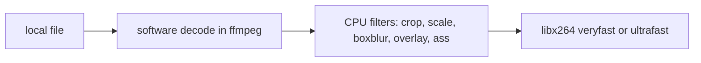

# GPU infrastructure

Coordinator note: promoted from Agent 2 draft (2026-11-20). No paid GPU provisioned. Aligns with SPEC S5 #99.

# GPU decode and encode, compared with the CPU path

Research note for ClutchClips, 2026-11-20. The question is whether NVIDIA's Accelerated Video for AI Playbook, PyNvVideoCodec, TorchCodec, Decord, or FFmpeg's NVDEC and NVENC should replace the CPU ffmpeg path for S5, ticket #99.

**Judgment.** Keep ffmpeg. Nothing measured here shows another library beating `libx264` on our filter graph. This machine has no NVIDIA GPU, so every GPU speed in this note is `not measured`. Vendor timings stay in [Vendor numbers that do not decide S5](#vendor-numbers-that-do-not-decide-s5) with the workload they actually ran.

Claim labels used below are `measured`, `verified`, `inferred`, `hypothesis`, `public-source`, and `not measured`. A label applies to the sentence it sits in.

## Overview

ClutchClips turns a long gameplay upload into short vertical clips. The section 14 goal is 30 to 50 ranked previews from a 2-hour VOD in 10 minutes, and one 1080p export in 30 seconds. Ticket #99 is the speed-track item that would time a GPU, and it is still an unwritten benchmark, not a library swap.

The shipping path decodes, filters, and encodes with one ffmpeg subprocess per call. `clip-api/app/pipeline/ff.py` puts `-protocol_whitelist file,pipe` on every input and kills the process when the job deadline runs out. `render.py` encodes with `libx264`. `signals.py` either skips video (`-vn`) or decodes a long stretch for on-screen chat. Captions, blur, and crops are CPU filters. A GPU decoder that hands frames back to that graph has to download them first.

S5 should stay a benchmark of this ffmpeg binary on a GPU the owner provides. PyNvVideoCodec, TorchCodec, and Decord are different processes with different failure modes. They do not earn a place in the image until one of them wins a timed run of the real graph, and this note does not have that run.

## Key concepts

NVDEC is the NVIDIA hardware video decoder. NVENC is the hardware encoder. FFmpeg exposes the decoder as `-hwaccel cuda` and as `*_cuvid` decoders, and the encoder as `h264_nvenc`, `hevc_nvenc`, and `av1_nvenc`. `public-source` from NVIDIA's FFmpeg chapter in the Video Codec SDK 13.1 docs. https://docs.nvidia.com/video-technologies/video-codec-sdk/13.1/ffmpeg-with-nvidia-gpu/

A CUDA frame is not a normal ffmpeg frame. Filters such as `scale` and `ass` read CPU memory. Getting a CUDA frame into them takes `hwdownload`. Filters with a CUDA twin, such as `scale_cuda`, can keep the frame on the device. Which twins exist is a property of the ffmpeg build, checked below.

Sparse output means we keep few frames. Sparse decode means the decoder does not walk the frames in between. Those are different. A filter of `fps=1/2` still decodes the pictures and then drops them, unless the command also skips non-keyframes.

S5 is GitHub issue 99, "GPU and NVENC benchmark behind a flag (S5)". The issue body says to measure NVENC exports and GPU Whisper on a GPU worker, and to keep that path as config, not the default. Acceptance criteria are still the placeholder line. The issue is open, unassigned, and marked optional. `verified` from the issue body fetched 2026-11-20. https://github.com/salaarkhan123/gta-clipping-pipeline/issues/99 GPU Whisper is outside this note.

## How the CPU path works

`run_pipeline` in `clip-api/app/pipeline/__init__.py` probes, detects a facecam, builds per-second signals, and later renders each chosen window. Every media read goes through `ff.run` or `ff.run_bytes`. Both pass the remaining deadline as the subprocess timeout, close stdin, and on a non-zero exit raise `PipelineError`. `verified` in `ff.py`.

Probe is `ffprobe` with the protocol whitelist, a 120 second cap, and a JSON read of duration, size, and whether an audio stream exists. It does not decode the picture.

Audio level is `audio_rms_db`. The command uses `-vn`, so the video decoder never starts. `extract_audio` in `stt.py` is the same idea for a full 16 kHz WAV. A video GPU does nothing for these calls. `verified`.

Chat motion runs only when `chat_region` is not `none`. One ffmpeg reads the analysed span, drops audio, and applies `fps=2`, a crop of the chat band, `scale=480`, gray, `edgedetect`, `tblend`, and `signalstats`. There is no `-skip_frame`. SPEC section 5 says this is slow because it decodes every frame. The code matches that description. `verified`.

The visual index is not on the default clip path. `tools.py` calls `build_visual_index`. `visual.py` keeps one frame every `STEP = 2.0` seconds, scaled to 224, and embeds it with ONNX CLIP. The module docstring says the embedder is CPU only and does not use PyTorch. When the median keyframe gap in the first 90 seconds is 4 seconds or less, the decode adds `-skip_frame nokey`. Otherwise it decodes the file and lets `fps=1/2` drop frames. The kept frames are sparse. The decode is a sequential pass. `verified`.

Facecam detection takes 12 gray frames. `sample_gray` starts a separate ffmpeg for each timestamp, with `-ss` before `-i`, `-frames:v 1`, and a scale to width 640. That is twelve short seeks, not one sequential decode. `verified` in `facecam.py` (`samples: int = 12`) and the `facecam_detect` stage in `run_pipeline`.

`render_clip` seeks with `-ss` before `-i`, reads `-t` for the window, runs the filter graph, and encodes. Export settings are `FULL_ENCODE = ["-preset", "veryfast", "-crf", "20"]`. Preview settings are `PREVIEW_ENCODE = ["-preset", "ultrafast", "-crf", "30"]` and a short side of 540. Audio is AAC. The vertical graph comes from `layouts.py` and uses `crop`, `scale`, `boxblur`, `overlay`, and, when words or a hook exist, `ass`. Loudness is a second ffmpeg with `-vn` and `ebur128`. The thumbnail is one frame of the finished clip. `verified`.

A hardware decode only removes the first box. The caption and blur filters still need CPU frames. A hardware encode only replaces the last box, and only after those filters have finished.

## Where things live

| Path | Role |
|---|---|
| `clip-api/app/pipeline/ff.py` | Subprocess timeout and `-protocol_whitelist file,pipe` |
| `clip-api/app/pipeline/signals.py` | Full-span chat-motion decode, audio-only levels |
| `clip-api/app/pipeline/visual.py` | Sequential frame sample for the ONNX index |
| `clip-api/app/pipeline/facecam.py` | Twelve one-frame seeks |
| `clip-api/app/pipeline/render.py` | Windowed decode, CPU graph, `libx264` |
| `clip-api/app/pipeline/layouts.py` | `crop`, `scale`, `boxblur`, `overlay` graph |
| `clip-api/Dockerfile` | `apt-get install ffmpeg` on `python:3.12-slim`, user `app`, no CUDA packages |
| `SPEC.md` section 14 | Goal, CPU render worker, S5 as ticket #99 |
| Issue 99 | Benchmark NVENC exports and GPU Whisper, off by default |

`requirements.txt` lists numpy, faster-whisper, fastembed, and opencv-python-headless. It does not list torch, torchcodec, decord, or pynvvideocodec. `verified` by reading the file.

`libx264` and the protocol whitelist have been in the tree since the initial commit `cdf0d24` on 2026-11-15. No later commit message on these files records a second decision. `verified` from `git log -S`. The comment in `ff.py` says uploaded files are untrusted and ffmpeg must not follow a URL inside the container. SPEC section 5 repeats the whitelist rule. Those sentences are the written reason for the input flag. `verified`.

## What this ffmpeg build can already name

Measured on this Cloud Agent VM, Ubuntu ffmpeg `6.1.1-3ubuntu5`, configure line includes `--enable-gpl` and `--enable-libx264` and does not include `--enable-nonfree`.

`ffmpeg -encoders` lists `h264_nvenc`, `hevc_nvenc`, and `av1_nvenc`. `ffmpeg -decoders` lists `h264_cuvid`, `hevc_cuvid`, and `av1_cuvid`. `ffmpeg -hwaccels` lists `cuda`. `ffmpeg -filters` lists `scale_cuda`, `overlay_cuda`, and `hwupload_cuda`. It also lists CPU `ass`, `subtitles`, `boxblur`, `crop`, `edgedetect`, `fade`, `fps`, `gblur`, `signalstats`, and `tblend`, and it does not list a `_cuda` twin for any of those. `boxblur_opencl` is present. The layout uses `boxblur`, not the OpenCL filter. `measured`.

`nvidia-smi` is absent. `/dev/nvidia*` is absent. `ldconfig` has no `libcuda`. A 0.2 second `h264_nvenc` encode of a `lavfi` test pattern exits 255 with `Cannot load libcuda.so.1` and writes no packets. That is a missing library, not a speed. `measured`. GPU encode and decode throughput on this VM are `not measured`.

The production Dockerfile installs distro ffmpeg and never mentions a NVIDIA package. The image's exact ffmpeg version and whether its build lists `h264_nvenc` were not inspected. `inferred` that the image as written has no CUDA user-space library, because the Dockerfile does not install one.

## Comparison

| Option | License | Maintenance, as of this reading | Hardware | Production fit against `run_pipeline` | Sparse frames | Full decode |
|---|---|---|---|---|---|---|
| CPU ffmpeg, today's path | GPL build on this VM, because `--enable-gpl` and libx264 | Distro package. We already run it | CPU | The path that has deadlines, the whitelist, libass, and the layout graph | Seeks in `facecam.py`. Sequential drop in `visual.py` | Chat motion and each render window |
| NVIDIA playbook | MIT for the repo | Notebooks. Manual install "not maintained and not tested" | NVIDIA GPU, NGC PyTorch container | Not a library to import | Sample indices in a demo dataloader | DALI and PyNv sequential demos |
| PyNvVideoCodec | MIT for the Python library | NVIDIA says it is the supported successor of archived VPF. PyPI lists 2.2.4 | NVIDIA GPU, Turing or newer, driver and CUDA | Encode and decode to tensors. No libass, no our graph, in-process | `SimpleDecoder` index API | `ThreadedDecoder` prefetch |
| TorchCodec | BSD-3. CUDA wheels add the CUDA EULA | Meta. README documents 0.17 against torch 2.11 and newer | CPU, or NVIDIA GPU for NVDEC | Pulls PyTorch into an ONNX pipeline. Still FFmpeg underneath | `get_frames_at`, `get_frames_played_at` | Iteration and slice syntax |
| Decord `dmlc/decord` | Apache-2.0 | Last GitHub release v0.6.0 on 2021-06-14. Last push 2024-07-17. Issue 333 still asking for a maintainer in 2025 | CPU wheels. GPU only from source | Stale, no layout encode, in-process | `get_batch` by index | Iterator and `next` |
| FFmpeg NVDEC and NVENC | Same ffmpeg binary. Header package `nv-codec-headers` is described as MIT by Fedora. NVIDIA's own compile example still passes `--enable-nonfree` | FFmpeg upstream plus the driver | NVIDIA GPU, driver present, `libcuda.so.1` loadable | Only option that keeps `ff.run`, the whitelist, and libass | `-ss` before `-i`, same as today | `-hwaccel cuda` on a long read |

The playbook, PyNvVideoCodec, TorchCodec, and Decord rows are `public-source` for license and hardware, and `inferred` for production fit from our code plus those pages. The ffmpeg rows mix `measured` build facts with `verified` call sites. No row has a ClutchClips frames-per-second number.

## NVIDIA Accelerated Video for AI Playbook

The repo is https://github.com/NVIDIA-AI-Technology-Center/accelerated-video-for-ai-playbook. The README fetched this session calls it a set of notebooks on video data loading for training. The license line says MIT. The tested entry point is `nvcr.io/nvidia/pytorch:26.03-py3` with `--gpus all`. A manual install outside that container is "not maintained and not tested". The closing disclaimer says the library tests are best effort and "not to be considered a professional benchmark". `public-source`.

Libraries the README tells you to install are DALI, PyNvVideoCodec, PyAV, Decord, TorchCodec, and OpenCV. DALI is already in the NGC PyTorch image. TorchCodec wheels may not load inside that image because of ABI differences, and the README says to build TorchCodec from source in that case. GPU OpenCV in the same README is a from-source build that copies `libnvcuvid.so` out of the Video Codec SDK after a login. `public-source`.

**License.** MIT for the playbook repo. Each library keeps its own license.

**Maintenance.** Active enough to name a 26.03 container and to warn that the tests are not a professional benchmark. The path we would actually ship, a slim CPU image, is the path they say they do not maintain.

**Dependencies.** An NGC PyTorch container, a GPU, and pip packages on top. That is a different image from `python:3.12-slim` plus `apt-get install ffmpeg`.

**Hardware.** Any run command in the README uses `--gpus all`. No CPU-only track is the recommended one.

**Production fit.** Poor as a dependency. It is a reading list for whoever runs the S5 bench. It does not know about `SAFE_IN`, `Deadline`, libass, or credit refunds. Our facecam detector uses OpenCV's Haar cascade on gray frames that ffmpeg already decoded. Following the playbook into a CUDA OpenCV rebuild would not remove those ffmpeg seeks. `verified` for our OpenCV use, `inferred` for the fit.

**Sparse frames and full decode.** The checked-in `assets/pynvc_dataloader.py` builds eight frame indexes with `np.linspace` across a short clip, seeks to index 0, and calls `get_batch_frames_by_index`. Output frames are DLPack tensors on the GPU. The sample assumes equal frame sizes and a training `DataLoader` with `num_workers=0`. That is sparse indexes inside a fully indexed short file, not a 2-hour seek pattern, and it was not run here. `public-source` for the script, `not measured` for speed.

## PyNvVideoCodec

NVIDIA's developer page says PyNvVideoCodec is the supported Python API on the Video Codec SDK, distributed MIT, installed with `pip install PyNvVideoCodec`, and the successor of Video Processing Framework. VPF's GitHub repo is archived and its license file is Apache-2.0. `public-source`. https://developer.nvidia.com/pynvvideocodec and https://github.com/NVIDIA/VideoProcessingFramework

PyPI lists `pynvvideocodec` 2.2.4, MIT, Python `>=3.8`, maintainer nvidia. `public-source`. https://pypi.org/project/pynvvideocodec/

**License.** MIT for the Python distribution NVIDIA describes. The driver and the CUDA toolkit stay under NVIDIA's licenses. The system-requirements page requires a CUDA toolkit on discrete GPUs. `public-source`. https://docs.nvidia.com/video-technologies/pynvvideocodec/read-me/latest/system-requirements-common.html

**Maintenance.** NVIDIA's pages call it officially supported. VPF's README says it is replaced. This session did not read a changelog date for 2.2.4, so the release clock is `not measured` beyond the version string on PyPI.

**Dependencies.** A pip wheel, a current NVIDIA driver, and a CUDA toolkit when building samples or using PyCUDA. The programming guide's benchmarks also want ffmpeg on `PATH` to generate test clips. Linux x86_64 wheels on the requirements page are Python 3.10 through 3.14, glibc 2.28 or newer. `public-source`.

**Hardware.** The developer page lists GPU families "Turning, Ampere, Ada, Hopper and Blackwell" and a Linux driver of 530.41.03 or newer. "Turning" is the spelling on that page. The requirements page lists the same families as Turing and newer, plus Jetson Thor and DGX Spark. No bench in this note checked either driver floor. `public-source`.

**Production fit.** It decodes and encodes on the GPU and can hand a frame to PyTorch through DLPack. It does not run `ass`, `boxblur`, or our crop graph. Using it for `render_clip` means writing a second compositor or downloading frames into ffmpeg, which puts the CPU graph back in the middle. It is an in-process library, so `ff.run`'s timeout does not cover it unless we add one. A stuck decode would sit inside the worker until something else notices. `inferred`. It also does not apply `-protocol_whitelist`. A wrapper would have to refuse anything that is not a local file. `hypothesis` that a path-only API is safe if we only pass paths we already store. Untested.

**Sparse frames.** `SimpleDecoder` supports index, slice, `get_batch_frames_by_index`, and `seek_to_index`. The API page says it needs a seekable container and will not take a raw elementary stream. `ThreadedDecoder` is the sequential prefetch class. `public-source`. https://docs.nvidia.com/video-technologies/pynvvideocodec/pynvc-api-reference/latest/decoder.html Random indexes still decode from the previous keyframe. Their own sampling note says a GOP of 250 frames leaves direct sampling only about 1.05 times the speed of decoding sequentially, on their 1080p clip. See the vendor section. That pattern matches a long-GOP upload better than a short-GOP training clip. `hypothesis` for our files, because this session did not measure their keyframe gaps.

**Full decode.** `ThreadedDecoder` is the class they point at for sequential pipelines. Chat motion is the call site that looks like that, and it then runs `edgedetect` and `signalstats`, which are CPU filters in the build measured above. The frames would come back to the CPU anyway. `inferred`.

## TorchCodec

Repo https://github.com/meta-pytorch/torchcodec. The README fetched this session says BSD-3, and says a CUDA-enabled build or wheel is also under NVIDIA's CUDA EULA. https://docs.nvidia.com/cuda/eula/index.html `public-source`.

The same README says TorchCodec decodes and encodes by calling the FFmpeg already installed, versions 4 through 9, shared libraries. `VideoDecoder(..., device="cuda")` is the NVDEC path. `get_frames_at` and `get_frames_played_at` are the sparse APIs. There is an `Encoder` for writing tensors back out. Current documented line is torchcodec 0.17 with torch `>=2.11` and Python 3.10 through 3.14. `pip install torch torchcodec` on Linux installs CUDA wheels by default. `public-source`.

The 0.17 decoder docstring says a CUDA device uses the `"nvdec"` backend unless you switch to the `"ffmpeg"` CUDA backend, and `seek_mode` is `"exact"` or `"approximate"`. `public-source` from the stable module text. https://meta-pytorch.org/torchcodec/stable/generated_examples/decoding/basic_cuda_example.html

**License.** BSD-3, plus the CUDA EULA if the CUDA wheel is used.

**Maintenance.** The README ships a version table through 0.17 and a nightly. That is a maintained project as of this fetch. This session did not open the commit log, so the last commit date is `not measured`.

**Dependencies.** PyTorch and a shared FFmpeg in the supported major range. This VM's ffmpeg is 6.1.1 and was built `--enable-shared`, which sits inside the stated range. Whether the wheel's sonames match this Ubuntu build was not tested, because torchcodec was not installed. `measured` for the local ffmpeg version, `not measured` for an import.

**Hardware.** CPU works without a GPU. CUDA decode and encode need a GPU whose NVDEC and NVENC support the codec. The README points at NVIDIA's support matrix and shows a `ffmpeg -hwaccel cuda` smoke command. That command cannot succeed on this VM. `not measured`.

**Production fit.** Weak for this service. `visual.py` states the embedder is CPU only and does not use PyTorch. `requirements.txt` has no torch. A CUDA wheel on the slim image is a new base image, a new license review, and a new failure mode inside the worker process rather than a killed subprocess. TorchCodec can replace the decode step of the visual index and still must copy tensors to NumPy for ONNX. It cannot burn ASS or draw the layout. Encoding from tensors would bypass `layouts.py`. `verified` for the PyTorch absence, `inferred` for the fit.

**Sparse frames.** `get_frames_played_at(seconds=[...])` is the closest API to `sample_gray`. Exact seek mode is the one that matches a facecam sample. It still decodes from the previous keyframe inside FFmpeg. Twelve separate `VideoDecoder` objects would repeat open and index costs. One decoder and twelve timestamps is the shape worth timing, and it was not timed. `hypothesis`.

**Full decode.** Slicing and iteration are the sequential API. Chat motion and `iter_frames` are the call sites. Both need CPU pixels for filters or for ONNX. A CUDA tensor would be copied off the device before either consumer. `inferred`.

## Decord

`dmlc/decord` is Apache-2.0. The README describes `VideoReader` on CPU or GPU, `get_batch` by frame index, and an iterator. It says PyPI wheels are CPU only and the GPU path is a source build. `public-source`. https://github.com/dmlc/decord

GitHub's repo page, as returned in this session, shows the latest release as v0.6.0 on 2021-06-14, marked prerelease, and the last push on 2024-07-17. Issue 333, opened 2025-01-17 and still commented on 2025-10-17, says maintenance looks stopped and asks for a new maintainer. `public-source`. https://github.com/dmlc/decord/issues/333

A different project, `decord2` on PyPI, showed later uploads during the same search. It is not `dmlc/decord`. It was not reviewed and it is not a recommendation.

**License.** Apache-2.0.

**Maintenance.** The release the project itself still points at is from 2021, and an open 2025 issue is asking who owns the repo. That is a poor bet for a paid pipeline. `public-source`.

**Dependencies.** CPU `pip install decord`, or a source build against FFmpeg and, for GPU, the NVIDIA codec libraries. The playbook README repeats the source-build requirement for the GPU variant. `public-source`.

**Hardware.** CPU for the wheel. NVIDIA GPU only after a source build. Not installed and not run here. `not measured`.

**Production fit.** Poor. No encode of our graph, no libass, no subprocess timeout, and a stalled upstream. `get_batch` looks like the visual-index API, and the visual index already has a sequential ffmpeg reader. Replacing that reader with an unmaintained binding does not remove the ONNX embed, which is the work after the frame exists. `inferred`.

**Sparse frames.** `get_batch([indexes])` is the documented random-access call, and the README says duplicate indexes are decoded once. Accuracy of those seeks on long VODs was not tested. `public-source` for the API, `not measured` for correctness on our files.

**Full decode.** The iterator is the sequential API. It does not offer `edgedetect` or `ass`. A full chat-motion decode would still be a second CPU pass, or a rewrite of the signal in Python. `inferred`.

## FFmpeg NVDEC and NVENC

This is the only option that stays inside `ff.run`. The binary on this VM already lists the encoders, the CUVID decoders, and `cuda` hwaccel. It cannot open them, because `libcuda.so.1` is not installed. `measured`.

NVIDIA's SDK 13.1 FFmpeg chapter says Turing and newer GPUs, a driver that matches the SDK headers, and frames kept on the GPU with `-hwaccel cuda -hwaccel_output_format cuda` plus `scale_cuda` and `h264_nvenc`. The chapter's configure example includes `--enable-nonfree`. This VM's Ubuntu build lists the NVENC encoders without that flag in `ffmpeg -version`. Both observations stand. This note does not pick a license interpretation beyond them. `public-source` for the chapter, `measured` for the local configure line. Fedora's `nv-codec-headers` package page calls those headers MIT. `public-source`. https://packages.fedoraproject.org/pkgs/nv-codec-headers/nv-codec-headers/index.html

**License.** We already ship a GPL ffmpeg because of libx264. Turning on an encoder that the same binary already compiled does not add a Python package. It does add the NVIDIA driver on the machine that runs it. Whether a given build needs `--enable-nonfree` depends on that build. Ours, on this VM, did not use the flag and still lists the encoder. The production image was not opened. `measured` here, `not measured` in the image.

**Maintenance.** FFmpeg and `nv-codec-headers` are upstream projects we would not vendor. The worker keeps calling `/usr/bin/ffmpeg`. Driver upgrades become the owner's problem on the GPU box, which SPEC already assigns to the owner. `verified` for the SPEC sentence that the owner provisions and pays, and that an agent does not sign up for infrastructure.

**Dependencies.** A GPU, a driver, and `libcuda.so.1`. No new Python dependency. The protocol whitelist can stay on the same command line, because the input is still a local file. Whether `cuda` hwaccel accepts that flag was not run. `hypothesis` that it does, because the whitelist limits protocols and the file is a file. Do not ship the flag on that guess.

**Hardware.** NVIDIA GPU with NVENC and NVDEC for the codecs we actually receive. Gameplay uploads are commonly H.264 or HEVC. AV1 exists on the encoder list and was not surveyed in our objects. Codec mix of real uploads is `not measured` in this session.

**Production fit.** Best of the GPU options, and still not good enough to turn on. `render_clip` would pass `-c:v h264_nvenc` instead of `libx264`, or add `-hwaccel cuda` in front of the input. The graph would then hit a CPU filter with no CUDA twin. From the filter list measured above, `scale` and `overlay` could move to `scale_cuda` and `overlay_cuda`. `crop`, `boxblur`, `fade`, `fps`, and `ass` could not. `ass` is the caption burn. A legal command downloads the frame, runs those filters, and uploads again if the encoder wants CUDA input. That download sits on the critical path of every captioned preview. `inferred` from the filter list. Speed of that round trip is `not measured`.

NVENC does not take `-crf 20`. NVIDIA's chapter shows bitrate and NVENC presets. A quality match to `veryfast` CRF 20 and to preview CRF 30 was not compared. Shipping a faster encoder that looks different is a product change, not a free speedup. `public-source` that the controls differ, `not measured` for our pictures.

**Sparse frames.** The facecam command is already a one-frame `-ss` seek. NVDEC would still start at the previous keyframe, decode to the target, and download one 640-wide gray frame. Twelve process startups plus twelve session inits can cost more than twelve CPU seeks. `hypothesis`. The visual index is not this shape. It is one sequential process.

**Full decode.** Chat motion and a render window are sequential reads. NVDEC can decode those streams. Chat motion's consumers are CPU filters with no CUDA twin, so the decode win is only the decode itself, and only if download of 2 frames per second is cheaper than software decode of the source. Render windows are short relative to a 2-hour file. SPEC section 14 says not to decode two hours into a proxy, because decoding the whole file costs more than rendering the preview windows from the source. A full-file GPU decode fights that sentence. `verified` for the SPEC sentence, `hypothesis` for which side would win on a GPU.

Preview encode is already `ultrafast`. The export encode is `veryfast`. If a later profile says the CPU filters dominate `render_clip`, NVENC will not move the 10-minute goal. SPEC's server run on 2026-11-15 records rendering as about 59 percent of processing on a 4 vCPU droplet, for the whole render stage, not for the encoder alone. The split inside that stage is `not measured`. The Apple Silicon chat-region run in the same section, 42.68 seconds to 279.22 seconds, is a CPU laptop number, not a GPU number, and it was not repeated here. `verified` that SPEC records those figures.

## Sparse output is not a sparse decode

| Call | Command shape | What is decoded | GPU decoder likely matters |
|---|---|---|---|
| `audio_rms_db`, `extract_audio`, `measure_loudness` | `-vn` | No video | No |
| `onscreen_chat_motion` | one process, `fps=2`, no skip | The analysed span, then 2 frames per second kept | Only if the download of those frames beats software decode. `hypothesis` |
| `iter_frames` | one process, `fps=1/2`, optional `-skip_frame nokey` | Whole file, or keyframes when the gap is 4 seconds or less | Same, and the next step is CPU ONNX. `hypothesis` |
| `sample_gray` | 12 processes, `-ss` then one frame | About one GOP per seek | Unlikely. Startup can dominate. `hypothesis` |
| `render_clip` | `-ss` and `-t` around one window | That window, then the CPU graph, then `libx264` | Encode might, after a profile says encode is the large part. `hypothesis` |
| `render_thumb` | one frame of the finished clip | One frame | No |

SPEC section 14 says visual analysis runs on sparse frames. The implementation keeps sparse frames. It does not issue sparse seeks, except the facecam sampler and the per-clip render seek. Reading "sparse frames" as "NVDEC random access will skip the decode" does not match `visual.py`. `verified`.

## Vendor numbers that do not decide S5

These numbers are NVIDIA's, from the PyNvVideoCodec programming guide fetched this session. https://docs.nvidia.com/video-technologies/pynvvideocodec/pynvc-api-prog-guide/latest/application-note.html They are `public-source`. They are `not measured` on our code, our files, or this VM. They are not a reason to replace ffmpeg.

The decision a speed number would change is "stop calling `libx264`". The bar is a repeated run of `render_clip`'s real graph, including `ass` when captions are on, against `veryfast` CRF 20 and `ultrafast` CRF 30, with the run-to-run spread smaller than the gap, on a GPU the owner provides, reported with `scripts/job_timings.py`. None of the vendor tables clear that bar.

**Decoder cache, short clips.** Cached decoder versus a new decoder, 2-second videos, many reuses, on their GPU. At 360p they report 7.2 times the frames per second, 12679 versus 1760. At 1080p they report 1.8 times, 2602 versus 1461. For 30-second videos they report about 1.02 to 1.3 times. They attribute the gap to decoder startup. The page does not print a repeat count or a spread. Our previews are longer than 2 seconds and they spend their time in CPU filters this library does not run. The 7.2 times figure measures startup on a tiny synthetic clip.

**Segmented transcode versus hardware ffmpeg.** One L40G, Ubuntu 22.04, a generated 1080p H.264 mandelbrot source, GOP 250, ten segments of 5 seconds, NVENC preset P1, zero B-frames. PyNvVideoCodec 2.31 seconds and 1072 frames per second. "FFmpeg without map", which the page says is hardware ffmpeg, 6.36 seconds and 389 frames per second. About 2.8 times in their table. One published row. No libass, no boxblur, no crop, no loudness, and not `libx264`. The page says the gap is persistent GPU context versus starting the encoder again. That is a real mechanism to remember when S5 times many short exports. It is not a measurement of our graph, and the ffmpeg side is not our CPU encoder.

**Seek versus sequential, same library.** On a 1080p, 30-second clip, uniform sampling of 30 frames at GOP 250 is 1.05 times sequential decode. At GOP 30 it is 1.44 times. Random sampling at GOP 250 is described as barely ahead of sequential, and at GOP 30 about 2.14 times, one thread. They state the limiter as how many frames sit between keyframes. `keyframe_gap` in `visual.py` already measures that gap for an upload and was not run on a real VOD in this session. `not measured` for our sources.

The playbook README says its own notebooks are not a professional benchmark. This note does not import any frames-per-second figure from those notebooks.

## Gotchas

The render stage in the 2026-11-15 server table is the whole ffmpeg invocation. Treating 59 percent as an encode-time budget would overstate what NVENC can return. `verified` that the table does not split the stage.

`ass` and `boxblur` have no CUDA filter in the ffmpeg measured here. A design that "does the render on the GPU" still has a CPU section in the middle of every captioned clip. `measured` for the filter list, `inferred` for the command shape.

In-process decoders do not inherit `Deadline`. The worker heartbeat is not a substitute for a kill on a stuck GPU session. Any non-ffmpeg experiment has to grow a timeout before it is allowed near a paid job. `verified` for `ff.run`, `inferred` for the gap.

`-protocol_whitelist file,pipe` exists because uploads are untrusted. A library that opens a path with its own demuxer must get the same local-file rule. This note did not audit those demuxers. `verified` for our rule, unknown for theirs.

Issue 99 names GPU Whisper in the same benchmark as NVENC. A decode library does not answer the Whisper half. SPEC setup B is still one 16-vCPU CPU render worker. An agent does not provision the GPU. `verified`.

NVENC preset P1 in the vendor transcode test is their fastest preset, not a quality match for CRF 20. Copying that preset into export would change pictures. `public-source` for P1 in their method, `not measured` for our quality bar.

`sample_gray` swallows a per-frame `PipelineError` and continues. A GPU seek that fails closed would change facecam behavior. That is a behavior change, not only a speed change. `verified` in `facecam.py`.

## What we do not know

No GPU was available, so there is no before-and-after with `scripts/job_timings.py`. `not measured`.

The production image's ffmpeg configure line was not read. It may or may not list `h264_nvenc`. `not measured`.

Keyframe gaps on real uploads were not measured, so the vendor GOP lesson is not yet a number for our VODs. `not measured`.

The share of `render_clip` spent in decode, in `boxblur` and `ass`, and in `libx264` was not profiled. `not measured`.

Whether `cuda` hwaccel works with our protocol whitelist was not run. `not measured`.

PyNvVideoCodec, TorchCodec, and Decord were not installed. Import, license files inside the wheels, and soname mismatches were not checked on disk. `not measured`.

Issue 99 has no acceptance criteria yet. What "enough faster" means is not written down. `verified` that the criteria are the placeholder.

## Sources consulted

Source control. `git log` and `git log -S` on `ff.py`, `render.py`, `signals.py`, and `visual.py`. The whitelist and `libx264` arrive in `cdf0d24` and the commit message does not discuss a GPU alternative.

Issue tracker. GitHub search on `salaarkhan123/gta-clipping-pipeline` for NVENC, GPU, and benchmark. Issue 99 is the S5 ticket. Other hits were unrelated benchmarks.

Long-form. `SPEC.md` sections 5 and 14, and `clip-api/Dockerfile`. No external docs system was available, so design notes that live outside the repo were not searched.

Real-time chat. No chat connector in this session. Skipped. The conversational record was not searchable.

Infrastructure metrics. No metrics connector. The only timings used are the ones SPEC already prints. They were not remeasured.

Error tracking. No error-tracker connector. Skipped.

Product analytics. No warehouse connector. Skipped.

This session could not spawn the parallel readers the investigation workflow asks for. The code, the issue, SPEC, and the public pages were read in one pass. Public pages were fetched this session rather than recalled.

Public pages read or fetched:

- https://github.com/NVIDIA-AI-Technology-Center/accelerated-video-for-ai-playbook (README)
- https://github.com/NVIDIA-AI-Technology-Center/accelerated-video-for-ai-playbook/blob/main/assets/pynvc_dataloader.py
- https://developer.nvidia.com/pynvvideocodec
- https://pypi.org/project/pynvvideocodec/
- https://docs.nvidia.com/video-technologies/pynvvideocodec/read-me/latest/system-requirements-common.html
- https://docs.nvidia.com/video-technologies/pynvvideocodec/pynvc-api-reference/latest/decoder.html
- https://docs.nvidia.com/video-technologies/pynvvideocodec/pynvc-api-prog-guide/latest/application-note.html
- https://github.com/NVIDIA/VideoProcessingFramework
- https://docs.nvidia.com/video-technologies/video-codec-sdk/13.1/ffmpeg-with-nvidia-gpu/
- https://github.com/FFmpeg/nv-codec-headers
- https://packages.fedoraproject.org/pkgs/nv-codec-headers/nv-codec-headers/index.html
- https://github.com/meta-pytorch/torchcodec (README and LICENSE)
- https://meta-pytorch.org/torchcodec/stable/generated_examples/decoding/basic_cuda_example.html
- https://github.com/dmlc/decord
- https://github.com/dmlc/decord/issues/333
- https://github.com/salaarkhan123/gta-clipping-pipeline/issues/99

Local commands. `ffmpeg -version`, `-encoders`, `-decoders`, `-hwaccels`, `-filters`, a failed `h264_nvenc` lavfi encode, `nvidia-smi`, `ls /dev/nvidia*`, and `ldconfig`.
