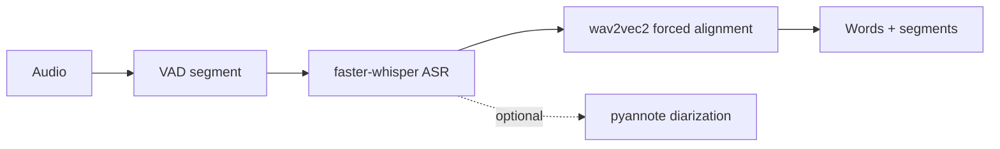

# Agent 3 — Transcription and audio (research draft)

**Scope:** Evaluate ASR options for ClutchClips against the in-production stack (`faster-whisper`, CPU `int8`) and the U1 transcript-reuse design on [PR #218](https://github.com/salaarkhan123/gta-clipping-pipeline/pull/218) (`release/step2-candidate`). **No production dependency changes.** Claim labels follow [RESEARCH.md](../RESEARCH.md).

**Code bases referenced**

| Tree | Branch | Label |
|---|---|---|
| Workspace checkout | `main` | `verified` — paths under `/workspace/clip-api/` |
| U1 `heard.py`, extended `stt.py` / `worker.py` | `release/step2-candidate` on PR #218 | `verified` — fetched via `gh api …?ref=release/step2-candidate` 2026-11-20 |

---

## 1. Executive summary

| Finding | Label |
|---|---|
| Production ASR is **faster-whisper** (`>=1.0` in `clip-api/requirements.txt`), **CPU**, **`compute_type="int8"`**, caption model **`small.en`** (`beam_size=5`, word timestamps on), index model **`base.en`** (`beam_size=1`, `words=False`). | `verified` — `clip-api/app/pipeline/transcribe.py`, `clip-api/app/worker.py`, `clip-api/Dockerfile`, `SPEC.md` §stack |
| On the **2026-11-15 DigitalOcean `s-4vcpu-8gb` server**, a **2h 1080p GTA benchmark VOD → 10 clips** totaled **932.7 s** wall time, of which **257.0 s** was attributed to **transcribing** (~28% of processing, ~59% was rendering). | `measured` — `SPEC.md` §B, job `job_c6d8edabf3fe44d18a33ebba` |
| **WhisperX** wraps faster-whisper but adds **PyTorch + torchaudio alignment + optional pyannote diarization**; it targets **word-timestamp accuracy and diarization**, not a lighter deploy than we have. | `public-source` — [WhisperX README](https://github.com/m-bain/whisperX/), [PyPI whisperx 3.8.6 deps](https://pypi.org/project/whisperx/) |
| **Silero VAD** is already used **inside faster-whisper** when `vad_filter=True`; standalone Silero only matters if we pre-segment audio outside Whisper or tune VAD aggressively. | `verified` + `public-source` — `transcribe.py`; [faster-whisper README VAD section](https://github.com/SYSTRAN/faster-whisper/blob/master/README.md) |
| **Do not replace faster-whisper** without **measured** proof on **our gaming VOD eval inputs** that a candidate is **better on transcript quality used by selection/captions** *and* **faster or cheaper** at equal or better quality. No such bench exists in this research run. | `policy` — owner brief + `RESEARCH.md` |

---

## 2. Current architecture (what runs today)

### 2.1 Two Whisper models, one library

| Role | Env | Settings | Used for | Label |
|---|---|---|---|---|
| Captions + clip candidate STT | `WHISPER_MODEL` (default `small.en`) | `beam_size=5`, `word_timestamps=True`, `vad_filter=True`, `condition_on_previous_text=False` | Candidate windows, burned-in captions | `verified` — `transcribe.py`, `worker.py` `default_transcriber()` |
| Full-video search index (Video Finder) | `WHISPER_INDEX_MODEL` (default `base.en`) | `beam_size=1`, `words=False` | Cheaper whole-file transcript for search | `verified` — `worker.py` `default_indexer()` |
| Multilingual | Derived from `.en` pair → `small` / `base` | Same beam/word rules per model | Non-English speech | `verified` — `clip-api/app/languages.py`, `transcribe.py` `for_language()` |

Models are **lazy-loaded**, **one CTranslate2 model per size per process**, with `device="cpu"` and `compute_type="int8"`. | `verified` — `FasterWhisperTranscriber._load()` in `transcribe.py`, `Dockerfile` bake step.

**Gaming-oriented post-filters** (not in Whisper itself): segments with high `no_speech_prob`, low `avg_logprob`, bracketed stage directions, and a static **exclamation phrase list** for scoring. | `verified` — `transcribe.py`, `EXCLAMATIONS` / `exclamation_hits()`.

**Audio ingest for Whisper:** 16 kHz mono PCM via ffmpeg (`extract_wav`) or `slice_wav` from a one-time `extract_audio` WAV (`stt.py`). | `verified` — `transcribe.py`, `stt.py`.

### 2.2 Clip pipeline vs whole-file transcription

| Path | Behavior | Label |
|---|---|---|
| **Clip Maker (default)** | Transcribes **candidate windows only** (≈2× requested clips, padded; judge uses larger pad). Does **not** decode full 2h audio to WAV unless a caller opts in. | `verified` — `SPEC.md` §pipeline step 5; `stt.py` module docstring |
| **Video Finder / transcript tool** | **Whole recording** via `LocalProvider.transcribe_file`: ~300 s chunks at RMS-quiet cuts; `TRANSCRIBE_PARALLEL` thread pool. | `verified` — `stt.py`, `config.py`, `DEPLOY.md` |
| **Reuse (main)** | If Video Finder already stored `transcript.json`, Clip Maker **reuses** that transcript for the **rough** pass (`fast_transcriber`); **final caption pass** still uses `small.en`. | `verified` — `pipeline/__init__.py` `reuse`, `worker.py` |
| **Reuse (PR #218 / U1)** | **`Heard`** store: per-upload **pieces** by time range and **model id**; incremental `stt.complete()` only fills **gaps**; clip pipeline reads covered windows from `heard` instead of re-ASR. | `verified` — `heard.py`, `stt.complete()`, `worker.py` on `release/step2-candidate` |

### 2.3 Parallelism knobs (often confused)

| Knob | What it does | Default / guidance | Label |
|---|---|---|---|
| `FasterWhisperTranscriber.workers` ← `TRANSCRIBE_PARALLEL` | `num_workers` passed to **CTranslate2** inside **one** `WhisperModel` | Set in `worker.py` before first load | `verified` |
| `LocalProvider.parallel` ← same env | **Thread pool**: multiple **chunk files** transcribed concurrently, each calling the **same** transcriber instance | Default **1**; DEPLOY says leave **1** on **4 vCPU** | `verified` — `stt.py`, `DEPLOY.md` |
| `chunk_bounds()` | Splits whole WAV at ~`TRANSCRIBE_CHUNK_SEC` (300), snapping cuts to quietest ~1 s in ±15 s | Reduces word splits at chunk boundaries | `verified` — `stt.py` |

`inferred`: Running `TRANSCRIBE_PARALLEL>1` on a 4 vCPU host risks **oversubscription** (CTranslate2 threads × parallel chunks) with **duplicate model RAM**, which matches DEPLOY guidance to keep parallel at 1 there.

**Not used:** faster-whisper **`BatchedInferencePipeline`** (batch over segments on GPU/CPU). | `verified` — no import in `clip-api/`; `public-source` — [faster-whisper README “Batched Transcription”](https://github.com/SYSTRAN/faster-whisper/blob/master/README.md).

---

## 3. Measured baseline and what “257 s transcribing” means

### 3.1 Server numbers

| Metric | Value | Label |
|---|---|---|
| Input | `GTA_Benchmark_2Hours.mkv`, **2:00:18**, 1080p | `measured` — `SPEC.md` §B |
| Host | DigitalOcean **`s-4vcpu-8gb`**, production Docker image, Toronto | `measured` |
| Run B | 10 clips, **932.7 s** total, **257.0 s** transcribing, **578.4 s** rendering | `measured` |
| Run A (3 clips) | **675.4 s** total, **200.4 s** transcribing | `measured` |
| Transcribe share of processing | ~28–30% (rendering ~59–62%) | `inferred` from SPEC table |

### 3.2 Interpreting transcribe time

| Statement | Label |
|---|---|
| The **257 s** is **wall-clock STT stage time** for that **clip job** (rough + final passes, judge on Run B), **not** “time to transcribe 2 hours of audio.” | `verified` — pipeline design + SPEC stage breakdown |
| `scripts/job_timings.py` defines **`transcribe_x_realtime`** = (`transcribed_rough_sec` + `transcribed_final_sec`) / (`transcribe_rough` + `transcribe_final` stage seconds) when both exist. | `verified` — `clip-api/scripts/job_timings.py` |
| We did **not** re-run job `job_c6d8edabf3fe44d18a33ebba` in this research VM to recover `transcribed_*_sec` counters. | `not measured` |

`hypothesis`: For Run B with AI judge, most of the 257 s is **`small.en`** on **~10 final clips** plus **`base.en`** on **~20 rough candidates** (order ~ tens of minutes of **audio seconds processed**, not 7200 s). Gaming VODs add **game BGM and SFX**; our filters skip some junk but can also drop quiet callouts — quality impact is **untested** on the eval set in this doc.

---

## 4. faster-whisper (in use)

### 4.1 License, deps, maintenance

| Item | Detail | Label |
|---|---|---|
| License | **MIT** | `public-source` — [SYSTRAN/faster-whisper LICENSE](https://github.com/SYSTRAN/faster-whisper/blob/master/LICENSE) |
| Core deps | **CTranslate2**, **PyAV** (bundled ffmpeg libs), **onnxruntime** for VAD, Hugging Face hub for weights | `public-source` — PyPI / README |
| Pin | `faster-whisper>=1.0` | `verified` — `requirements.txt` |
| Maintenance | Releases **1.1.1 (2025-01)**, **1.2.0 (2025-08)**, **1.2.1 (2025-10)**; Silero VAD v6 in 1.2.1 | `public-source` — [GitHub releases](https://github.com/SYSTRAN/faster-whisper/releases) |
| Whisper weights | OpenAI checkpoints (e.g. `small.en`) — OpenAI MIT license on original models | `public-source` — OpenAI model cards |

### 4.2 GPU vs our CPU int8 choice

| Mode | When it helps | ClutchClips today | Label |
|---|---|---|---|
| CPU `int8` | No NVIDIA stack; predictable on DO droplet | **Production default** | `verified` — `transcribe.py`, `SPEC.md` |
| GPU `float16` / `int8_float16` | Large models, batched inference | **Not configured** on benchmark server | `measured` — no GPU in SPEC server run |
| Public CPU bench (13 min audio, **small**, 8 threads i7) | int8 **~1m42s** vs int8 batched **~51s** | Illustrative only — different CPU from DO | `public-source` — faster-whisper README |

`inferred`: Moving to GPU could cut whole-file indexing latency substantially **if** we accept NVIDIA drivers, VRAM, and image changes (see `docs/performance-research/GPU-INFRASTRUCTURE.md`), but **clip-window STT** may remain a small fraction of job time until render is optimized.

### 4.3 Features we already rely on

| Feature | Our usage | Label |
|---|---|---|
| `vad_filter=True` | Default in `options()` | `verified` |
| `get_speech_timestamps` | Language detection on first 30 s (multilingual path) | `verified` |
| Word timestamps | Captions, `snap_to_speech`, dead-air trimming | `verified` — `pipeline/__init__.py` |
| Raw numpy audio | Workaround for PyAV path breakage | `verified` — comment in `transcribe.py` |

### 4.4 In-repo upgrade levers (no engine swap)

| Lever | Effect | Risk | Label |
|---|---|---|---|
| Upgrade **1.0 → 1.2.x** | Silero VAD v6, batched API available, distil model support | Regression test `RUN_WHISPER_E2E=1` | `hypothesis` — needs CI/opt-in e2e |
| **`BatchedInferencePipeline`** on **index** path only | README claims large speedups on GPU; CPU int8 batched also faster on small model in public table | Memory spike; not integrated with `Heard` gaps | `hypothesis` |
| **`distil-large-v3`** / **`large-v3-turbo`** | Better speed/quality tradeoff per upstream | Heavier RAM; may need GPU for “north star” 2h index | `public-source` — README |
| Tune `vad_parameters` | Less music transcribed as speech on GTA beds | Could clip quiet speech | `hypothesis` — gaming VOD specific |
| `condition_on_previous_text=False` | Already set — reduces error propagation on long streams | — | `verified` |

---

## 5. WhisperX

### 5.1 What it adds on top of faster-whisper

| Layer | Purpose | Label |
|---|---|---|
| ASR backend | **faster-whisper** | `public-source` — WhisperX README |
| VAD | Segmenting / batching (pyannote + Silero mentioned) | `public-source` |
| Alignment | Finer **word boundaries** than Whisper alone | `public-source` |
| Diarization | Speaker labels | `public-source`; `speaker_provider: none` today — `config.py` |

### 5.2 License, deps, GPU

| Item | WhisperX | Label |
|---|---|---|
| Code license | **BSD-2-Clause** | `public-source` — [PyPI](https://pypi.org/project/whisperx/) |
| Python | `>=3.10`, `<3.14` | `public-source` |
| Heavy deps | **torch ~2.8**, **torchaudio**, **pyannote-audio >=4**, **ctranslate2**, **transformers** | `public-source` — PyPI dependency table |
| GPU | README/marketing: **<8 GB VRAM** for large-v2 beam 5; alignment/diarization add work | `public-source` |
| Diarization model | **CC BY 4.0** `speaker-diarization-community-1` (HF gate) | `public-source` — WhisperX README, [HF model card](https://huggingface.co/pyannote/speaker-diarization-community-1) |
| Alignment (non-EN) | GitHub issue: FR/DE/ES/IT default align models **CC-BY-NC 4.0** — **not OK for commercial** without substitutes | `public-source` — [whisperX#962](https://github.com/m-bain/whisperX/issues/962) |

### 5.3 Production fit for ClutchClips

| Criterion | Assessment | Label |
|---|---|---|
| **Speed vs our path** | Extra alignment (+ optional diarization) **adds** stages; batched WhisperX is fast on **GPU** for **full file**, but our clip path is **short windows** where alignment cost may dominate. | `hypothesis` |
| **Quality** | Likely better **subtitle word edges**; **WER** for game audio not measured here. | `not measured` |
| **Deploy** | Conflicts with **lean CPU image** (`SPEC.md` stack); large PyTorch wheel + HF tokens for diarization. | `inferred` |
| **Speaker ID** | Product has `speaker_provider: none`; WhisperX’s main differentiator is **partially deferred**. | `verified` — `config.py` |

**Conclusion:** WhisperX is a **caption/subtitle refinement** stack, not a demonstrated win over our **int8 faster-whisper** on **gaming clip selection** without benchmarks. Replacing the engine would **increase** deps and ops surface.

---

## 6. Silero VAD — standalone vs built-in

| Aspect | faster-whisper built-in (`vad_filter`) | Standalone `silero-vad` package |
|---|---|---|
| Integration | Called from `faster_whisper.vad`; upgraded with library (v6 in 1.2.1) | Separate ONNX + torch API |
| License | Bundled model via faster-whisper | **MIT** (weights + code) — `public-source` — [snakers4/silero-vad LICENSE](https://github.com/snakers4/silero-vad/blob/master/LICENSE) |
| Our code | `vad_filter=True` on every `transcribe()`; `get_speech_timestamps` for language probe | **Not imported** directly | `verified` |
| Chunking | `stt.chunk_bounds` uses **RMS energy**, not Silero | Could pre-cut clips before ASR | `verified` / `hypothesis` |

| Question | Answer | Label |
|---|---|---|
| Would standalone Silero help GTA VODs? | Might trim **long music-only** stretches before **whole-file** index; clip pipeline already uses **short windows**. Over-aggressive VAD could remove **quiet comms**. | `hypothesis` |
| Duplicate VAD? | Running Silero **before** faster-whisper VAD is **double work** unless we disable one. | `inferred` |

**Recommendation shape (research only):** Tune **`vad_parameters`** on faster-whisper first; only consider standalone Silero if whole-file index cost dominates after render optimizations — **measure** on 2h bench.

---

## 7. Batched transcription and chunk parallelism

### 7.1 Two different “batch” concepts

| Mechanism | Where | What it parallelizes | Label |
|---|---|---|---|
| **Chunk parallelism** | `LocalProvider` + `ThreadPoolExecutor` | **Independent 300 s files** | `verified` — `stt.py` |
| **BatchedInferencePipeline** | faster-whisper library | **Encoder batching** inside one model | `public-source` — README; **unused** in repo |

### 7.2 When chunk parallelism helps

| Condition | Expected outcome | Label |
|---|---|---|
| 4 vCPU DO droplet | **parallel=1** recommended | `verified` — `DEPLOY.md` |
| 8+ vCPU, whole 2h index | **2–4** parallel chunks **may** help if each chunk uses a subset of cores | `verified` guidance; `not measured` on our hardware |
| Clip candidates | Many short sequential `transcribe()` calls — chunk pool **does not apply** | `verified` |

### 7.3 Heard-aware whole-file transcription (PR #218)

`stt.complete(heard, …)`:

1. If no timed pieces → one `transcribe_file` (legacy behavior).
2. Else → compute **gaps**, transcribe **only gaps**, merge into `Heard`, return `doc_of`.

| Benefit | Label |
|---|---|
| Second clip job on same upload skips ASR on windows already covered by model rules | `verified` — `heard.py`, `stt.complete()` |
| Video Finder index + clip jobs share **pieces** via `transcript-parts.json` | `verified` — `worker.save_parts()` on PR branch |
| Model-aware: caption text only from caption model name (`model_of`, `:nowords`, `:beamN`) | `verified` — `heard.py` |

`inferred`: U1 lowers **marginal** transcribe cost for repeat jobs; first job on a 2h upload still pays full index if user runs Finder first (or `transcribe_whole` on PR branch).

---

## 8. Word-level timestamps — quality vs speed

| Setting | Speed | Downstream use | Label |
|---|---|---|---|
| `words=True`, `beam_size=5` (`small.en`) | Slowest per window; needed for captions | Caption burn-in, `snap_to_speech`, dead-air, word counts in features | `verified` |
| `words=False`, `beam_size=1` (`base.en` index) | Faster whole-file index | Search / rough judge text only | `verified` |
| WhisperX alignment | Extra pass; best lip-sync-grade edges | Subtitle polish; overkill if Whisper words suffice | `hypothesis` |
| `snap_to_speech` | Uses **segment** boundaries, not words | 4 s tolerance on edges | `verified` — `transcribe.py` |

| Tradeoff | Guidance | Label |
|---|---|---|
| Disable words on captions | **Large speed win** possible | **Breaks** caption rendering and word-based tightening | `inferred` from pipeline |
| Lower beam to 1 on `small.en` | Faster | **Risk** to exclamation / keyword scoring on eval | `hypothesis` — needs eval run |
| Keep dual-model strategy | Pay **quality tax** only on **winning** clips (final pass) | `verified` — `pipeline/__init__.py` rough vs final |

Public note: faster-whisper README states comparison across implementations must match **beam size** (their default 5 vs OpenAI whisper CLI default 1). | `public-source`.

---

## 9. Comparative matrix (production lens)

| Option | License (code) | Typical deps | GPU | Fits CPU droplet? | Gaming VOD evidence here | Maint. | Label |
|---|---|---|---|---|---|---|---|
| **faster-whisper (current)** | MIT | CTranslate2, onnxruntime, PyAV | Optional | **Yes** — in prod | **SPEC server bench** | Active 2025 releases | mixed |
| **WhisperX** | BSD-2-Clause | + PyTorch, torchaudio, pyannote, HF gates | Practical **yes** | **Poor** — image size & RAM | **None** | Active on PyPI | `public-source` + `not measured` |
| **openai/whisper (PyTorch)** | MIT | torch, ffmpeg | Yes | Poor | None | Maintenance mode vs CTranslate2 forks | `public-source` — README benchmarks |
| **whisper.cpp** | MIT | C++ binary | Optional | Possible sidecar | None | Active community | `public-source` |
| **Silero VAD alone** | MIT | torch/onnx | CPU OK | Yes | None for ASR quality | Active | `public-source` |
| **Hosted STT APIs** | SaaS ToS | HTTPS | N/A | Yes | None in repo | Vendor-specific | `hypothesis` — `PROVIDERS = ("local",)` only |

---

## 10. Gaming VOD–specific considerations (unbenchmarked)

| Factor | Interaction with ASR | Label |
|---|---|---|
| Continuous **game audio bed** | Raises `no_speech_prob` / junk lyrics; segments filtered in `transcribe()` | `verified` filters; `hypothesis` on recall |
| **Shoutouts / short callouts** | VAD may merge or skip; exclamation list boosts scoring when text survives | `inferred` |
| **Facecam / streamer mic** | Mono 16 kHz downmix — standard Whisper input | `verified` |
| **Chat TTS / teammates** | Same channel; no diarization — words attributed to one stream | `verified` — no diarization |
| **Multilingual streams** | Multilingual `small` model path; detection on 30 s | `verified` |

**Required before any engine swap:** WER or task-specific metrics (precision@k on transcript keywords, caption readability, exclamation hit rate) on `clip-api/eval/` + 2h bench **`scripts/job_timings.py`** before/after.

---

## 11. Research recommendations (not product decisions)

1. **Keep faster-whisper** as the ASR engine until a challenger beats **`small.en` captions** and **`base.en` index** on **both** eval quality and **transcribe_x_realtime** on the **DO 4 vCPU** profile. | `policy`
2. **Ship U1 (`Heard`)** when PR #218 lands — transcribe **gaps** only; expect **repeat-job** wins, not first-pass 2h clip magic. | `verified` design; `hypothesis` on savings %
3. **Tune in place:** try faster-whisper **1.2.x**, optional **`vad_parameters`** for music-heavy GTA files; document A/B on one 2h fixture. | `hypothesis`
4. **Index path only:** prototype **`BatchedInferencePipeline`** or **`distil-*`** on **`base.en` whole-file** job; keep clip path unchanged. | `hypothesis`
5. **Defer WhisperX** unless product mandates **frame-accurate karaoke** or **speaker labels**; if needed, run as **offline caption pass** on rendered clips, not hot path. | `inferred`
6. **Do not** set `TRANSCRIBE_PARALLEL>1` on 4 vCPU without `job_timings.py` proof. | `verified` ops guidance

---

## 12. Proposed benchmark checklist (`not measured` until run)

| # | Experiment | Metrics | Hardware |
|---|---|---|---|
| 1 | Whole 2h index: `base.en` int8, parallel 1 vs 2 vs 4 | wall, `transcribe_x_realtime`, RSS | DO 4 vCPU |
| 2 | Clip job 10 clips + judge: current vs beam 3 on final only | total transcribe s, eval precision | Same |
| 3 | faster-whisper 1.0.x vs 1.2.1, same models | same | Same |
| 4 | Optional GPU slot: int8 GPU index vs CPU | cost + time | Owner-approved GPU |
| 5 | WhisperX align-only on 5 clip WAVs vs our words | edge error ms, subjective caption QA | GPU VM |

Owner approval required for GPU/paid cloud per `RESEARCH.md`.

---

## 13. References

| Resource | URL / path |
|---|---|
| In-repo transcribe | `clip-api/app/pipeline/transcribe.py` |
| Whole-file STT | `clip-api/app/pipeline/stt.py` |
| U1 Heard (PR #218) | `clip-api/app/pipeline/heard.py` on `release/step2-candidate` |
| Timings helper | `clip-api/scripts/job_timings.py` |
| Deploy tuning | `clip-api/DEPLOY.md` |
| SPEC server bench | `SPEC.md` §B |
| PR #218 | https://github.com/salaarkhan123/gta-clipping-pipeline/pull/218 |
| faster-whisper | https://github.com/SYSTRAN/faster-whisper |
| WhisperX | https://github.com/m-bain/whisperX |
| Silero VAD | https://github.com/snakers4/silero-vad |
| WhisperX alignment licenses issue | https://github.com/m-bain/whisperX/issues/962 |

---

*Draft author: Potato Mode research Agent 3. Date: 2026-11-20.*